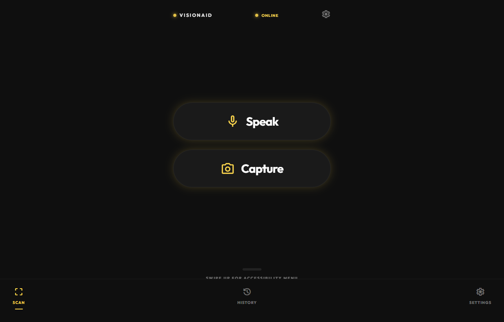
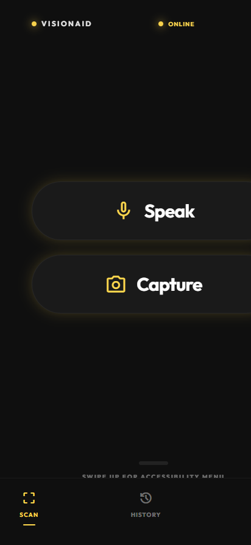
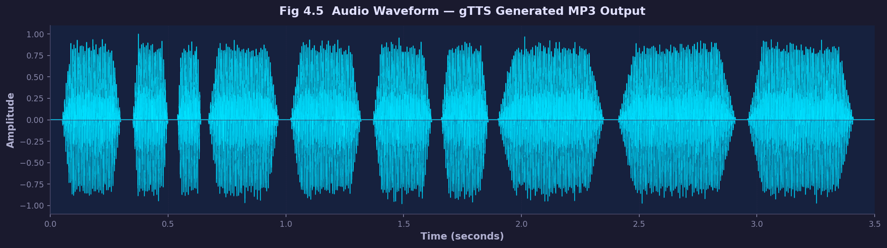
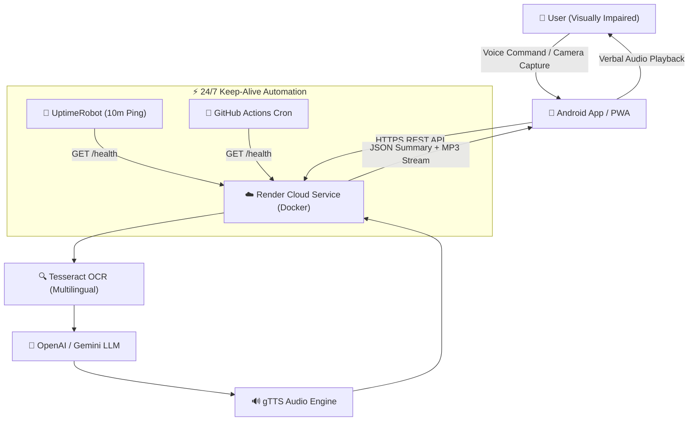

# 👁️ VisionAid AI - AI Accessibility Assistant

[](https://www.gnu.org/licenses/gpl-3.0)
[](https://visionaid-api.onrender.com)
[](https://dashboard.uptimerobot.com/monitors/804236184)
[-3DDC84?logo=android)](android_native/)
[](app.py)

> **VisionAid AI - AI Accessibility Assistant** is a multi-modal, verbal accessibility assistant designed to empower visually impaired and illiterate individuals. It transforms real-world visual and textual information into natural, concise verbal feedback across **15+ regional and global languages**.

---

## 🌐 Live Production Deployment

* **Live Web App:** [https://visionaid-api.onrender.com/](https://visionaid-api.onrender.com/)
* **Mobile Web PWA:** [https://visionaid-api.onrender.com/mobile](https://visionaid-api.onrender.com/mobile)
* **API Health Check:** [https://visionaid-api.onrender.com/health](https://visionaid-api.onrender.com/health)
* **Prebuilt Android APK:** [`VisionAid-cloud.apk`](VisionAid-cloud.apk)

---

## 📸 Screenshots & Visuals

### Desktop Web Dashboard


### Mobile Application View
<p align="center">
  
</p>

### Speech Synthesis & Waveform Generation


---

## 🚀 Key Features

* **📷 Multilingual Optical Character Recognition (OCR):**
  Deep integration with Tesseract OCR supporting 15+ languages including **Telugu (`tel`), Hindi (`hin`), Tamil (`tam`), Kannada (`kan`), Malayalam (`mal`), Marathi (`mar`), Bengali (`ben`), English (`eng`)**, and more.
* **🧠 Context-Aware AI Summarization:**
  Extracts key insights from complex documents, restaurant menus, and signboards using OpenAI GPT / Google Gemini models.
* **🗣️ Real-Time Speech Synthesis (TTS):**
  Synthesizes synthesized audio (`gTTS`) in the user's native dialect and serves it instantly with high fidelity.
* **📱 Native Android Application:**
  Built with **Jetpack Compose**, CameraX, Retrofit2, and Android TextToSpeech. Includes dynamic server switching so users can toggle between cloud and local hosts without modifying source code.
* **⚡ 24/7 Lifelong Zero-Cost Cloud Deployment:**
  Packaged as an automated **Docker container** hosted on **Render.com**, continuously kept awake via **UptimeRobot** and **GitHub Actions** cron pinging every 10 minutes.

---

## 🏗️ System Architecture



---

## 🔌 API Endpoints

| Method | Endpoint | Description | Sample Request |
| :--- | :--- | :--- | :--- |
| `GET` | `/health` | Service status check | `curl https://visionaid-api.onrender.com/health` |
| `POST` | `/upload-image` | OCR extraction + AI summary + TTS | Multipart Form: `image` (file), `lang` (e.g. `te`, `hi`, `en`) |
| `POST` | `/process-text` | Verbal question answering | JSON: `{"text": "What time is it?", "lang": "en"}` |
| `POST` | `/translate` | Neural language translation | JSON: `{"text": "Hello", "lang": "te"}` |
| `GET` | `/audio/<file>` | Streams generated MP3 audio | Direct audio playback stream |

---

## 🛠️ Local Development & Setup

### 1. Backend Setup
```bash
# Clone the repository
git clone https://github.com/rithvikkaki/VisionAid-AI-Accessibility-Assistant.git
cd VisionAid-AI-Accessibility-Assistant

# Create virtual environment
python -m venv .venv
source .venv/bin/activate  # On Windows: .venv\Scripts\activate

# Install dependencies
pip install -r requirements.txt

# Run backend locally
python app.py
```

### 2. Run Tests
```bash
pytest tests/ -v
```

### 3. Build Android App
```bash
cd android_native
./gradlew assembleDebug
```
The generated APK will be at: `android_native/app/build/outputs/apk/debug/app-debug.apk`.

---

## 📜 Strict Copyleft License

This project is licensed under the **GNU General Public License v3.0 (GPL-3.0)**.

### Summary of Strict Terms:
* ✅ **Open Source Guarantee:** Anyone who distributes or modifies this code must make the complete source code publicly available under the GPL-3.0.
* ❌ **No Proprietary Closed-Source Forks:** You cannot take this code, modify it, and sell or distribute it as proprietary closed software.
* ⚖️ **Mandatory Attribution:** Prominent copyright and author notices must be preserved on all distributions.
* See the full terms in the [LICENSE](LICENSE) file.

---

<p align="center">
  <b>Developed by Rithvik Kaki & Contributors</b><br>
  <i>Empowering Accessibility Through Multimodal AI</i>
</p>
